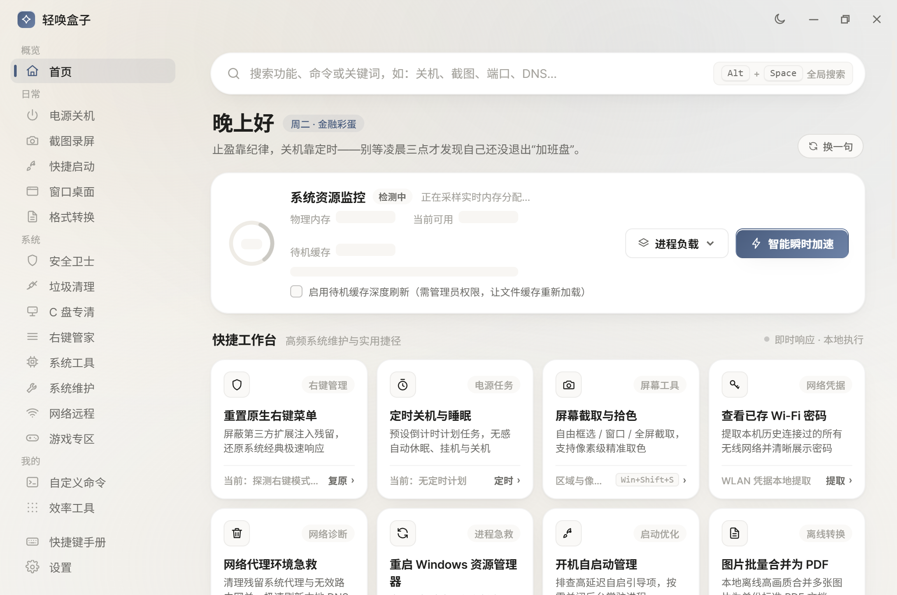
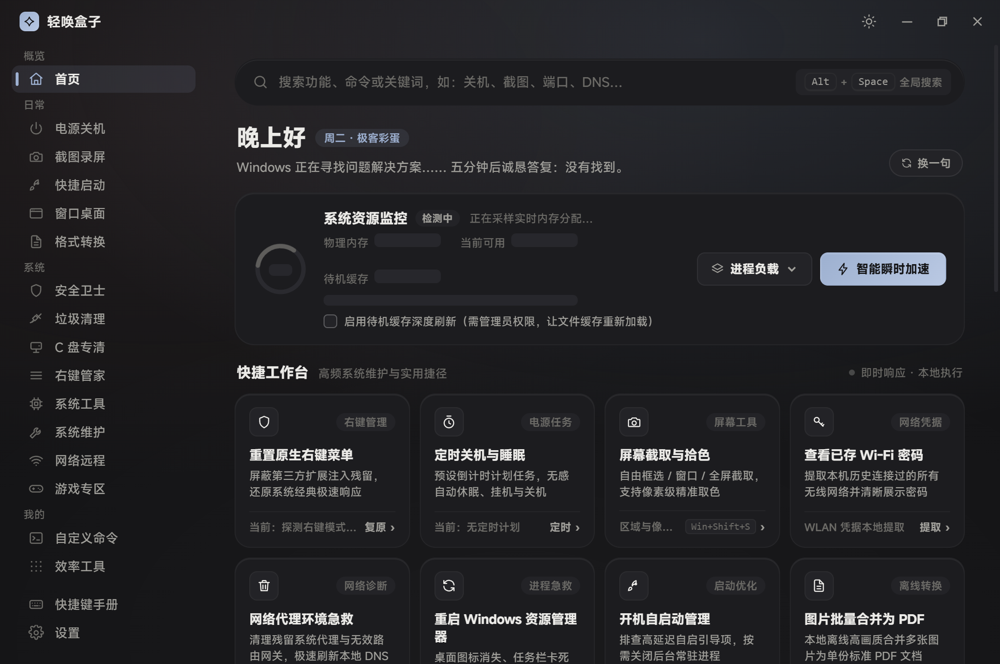
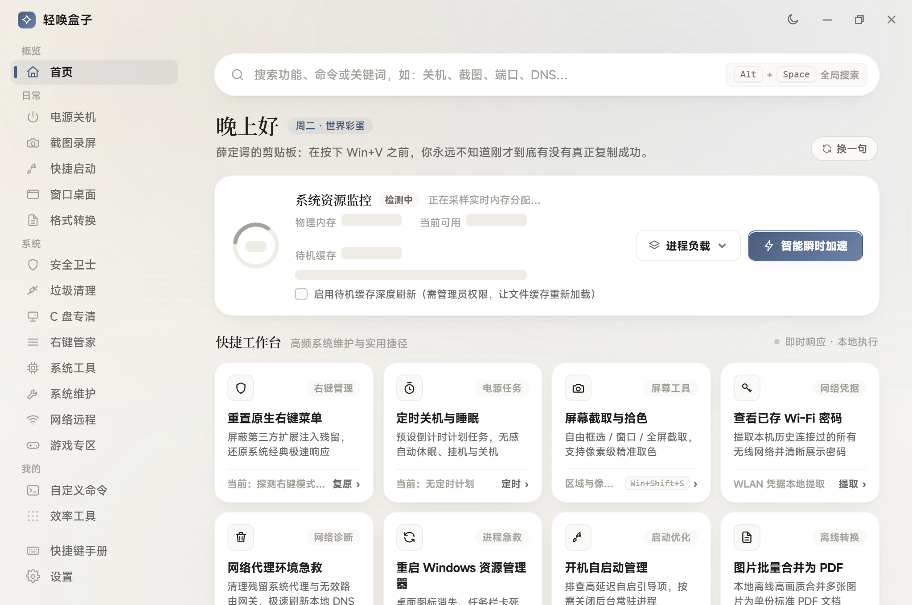

# WinCue · 轻唤盒子

> 一款安静、克制、全本地运行的 **Windows 桌面效率控制台**。  
> 把零散在命令行、控制面板、右键菜单和系统深处的 120+ 高频动作，收纳进 **Warm Paper / Calm Slate** 磨砂双色工作台与 `Alt + Space` 全局呼出面板中——不弹窗、不推广告、不上传任何数据。



---

## 设计与体验亮点

- **Warm Paper & Calm Slate 双色环境光**：柔和暖纸浅色与静谧深灰深色，统一全窗口无缝氛围底色，内置 5 套低饱和莫兰迪强调色板（雾石蓝 / 暖灰褐 / 鼠尾草绿 / 青黛墨 / 陶土玫瑰）。
- **5 套内置离线字体（开箱即切，不挑系统环境）**：
  - `思源黑体`（现代默认）
  - `MiSans`（小米 VF 可变无衬线，全字重离线内置）
  - `典雅混搭`（思源宋体标题 + MiSans 正文，杂志编排质感）
  - `霞鹜文楷`（温润手账风，SIL OFL 1.1 离线内置）
  - `思源宋体`（全站书卷衬线）
- **首页动态问候与跨界彩蛋**：按时段自动切换问候语，内置 50+ 条涵盖 **影视经典、游戏玩家、金融财经、世界科普、极客运维** 及深夜/周五档彩蛋文案，点击“换一句”无重复轮换，连击触发隐藏惊喜。
- **全局轻唤（Spotlight）**：随时按下 `Alt + Space`（设置页可自定义）呼出极速搜索框，支持中文 / 英文 / 拼音多词匹配、键盘上下直达，危险动作转主面板二次确认。

<p align="center">
  
  
</p>

---

## 核心功能全景

| 模块 | 代表能力 |
| --- | --- |
| **系统资源与加速** | 物理内存 / 待机缓存实时监测、后台高耗进程排行、一键工作集修剪与瞬时加速；全屏游戏快捷键 `Ctrl + F11` 毫秒级释放内存并提升游戏调度优先级 |
| **C 盘专清与无损搬家** | 原生 C# 高速扫描器分级扫描系统/应用冗余，支持大文件跨盘无损搬迁与回滚、保护系统核心目录不误删 |
| **右键与启动项管家** | 一键恢复 Windows 11 原生经典右键菜单、清理流氓右键注入、管理开机自启动项 |
| **电源与定时任务** | 立即关机/重启/睡眠/休眠/锁屏、**定时关机与定时睡眠**（基于系统原生任务，关闭软件依然生效） |
| **网络诊断与运维** | 端口占用反查进程、刷新 DNS、清理残留代理、查看已存 Wi-Fi 密码、SFC / DISM / 电脑信息面板 |
| **本地离线格式转换** | 多图合并 PDF、文本/Markdown 转 PDF、本机 Office 引擎 Word 转 PDF、MD5/SHA-1/SHA-256 校验、JSON/Base64 工具 |
| **自定义命令安全门** | 支持后台静默 / 终端运行 / 捕获输出；命中关机、删除、格式化、改注册表等 9 类风险特征自动高亮弹窗确认 |
| **快捷键手册** | 内置 Windows 通用、窗口桌面、截图、资源管理器、浏览器、Office、VS Code 等 8 组速查手册 |

---

## 快速使用（Windows 10 / 11 x64）

1. 前往 Releases 或本地 `release\WinCue-Portable.exe` 下载单文件便携版（无需安装 Node.js）。
2. 双击即开，关闭窗口默认最小化到右下角系统托盘，右键托盘可直接截图、锁屏、触发游戏加速或设定定时关机。
3. 可在「设置 → 外观」自由切换深浅模式、莫兰迪强调色与 5 套内置字体。

---

## 源码开发与打包

环境要求：Node.js 18+（Windows 宿主机）。

```powershell
npm install        # 安装 Electron 与打包依赖
npm start          # 启动开发模式
npm run smoke      # 运行主进程自动化冒烟自检
npm run dist:dir   # 生成免安装目录 release\win-unpacked
npm run dist       # 生成单文件便携版 release\WinCue-Portable.exe
```

---

## 安全、隐私与合规声明

- **纯本地零联网**：配置与收藏保存于本地 `%APPDATA%\WinCue\quickkeys-config.json`，不采集、不上传任何个人或设备数据；渲染进程开启 `contextIsolation: true` 并禁用 Node 集成。
- **源码开源协议**：本项目源代码依据 [MIT License](LICENSE) 开源。
- **内置第三方字体协议（不适用 MIT 再授权）**：
  - **MiSans VF**（`src/renderer/fonts/misans/`）：Copyright © Beijing Xiaomi Mobile Software Co., Ltd.，依据小米官方《MiSans 字体知识产权许可协议》无修改内嵌使用，禁止单独分发或修改字形轮廓。
  - **霞鹜文楷 Lite / LXGW WenKai Lite**（`src/renderer/fonts/wenkai/`）：Copyright © LXGW，依据 [SIL Open Font License 1.1](src/renderer/fonts/wenkai/OFL.txt) 分发使用。
- **原生辅助可执行文件**：`src/bin/` 中的 4 个小型 `.exe`（内存释放、热键监听、内存采样、磁盘扫描）均由同目录公开的 `*.cs` 源码经 Windows `.NET Framework csc.exe` 编译生成，完整重编指令见 [THIRD-PARTY-NOTICES.md](THIRD-PARTY-NOTICES.md)。
